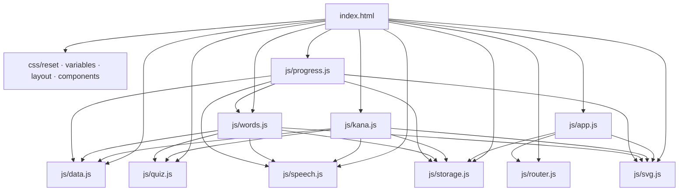

# 초등학생용 일본 애니메이션(열혈 소년만화·아케이드) 리디자인 구현 계획

> **For agentic workers:** REQUIRED SUB-SKILL: Use superpowers:subagent-driven-development to implement this plan task-by-task. Steps use checkbox (`- [ ]`) syntax for tracking.

**Goal:** 일본어 학습 웹앱을 초등학생 눈높이(단어 100개 개편, 발음 듣기, 도장/콤보 보상)와 열혈 소년만화·아케이드 디자인으로 전면 개편하고, 기존 퀴즈·저장소·이벤트 누수 버그를 모두 해결한다.

**Architecture:** 외부 프레임워크 없이 기존 Vanilla HTML/CSS/JS IIFE 모듈 구조를 유지하되, 루트 중복 파일을 정리하고 `svg.js`(Parametric SVG 마스코트·도장·집중선), `speech.js`(Web Speech API), `progress.js`(#progress 스티커북)를 추가한다. `Router.onCleanup`과 `AbortController`로 화면 이탈 시 리스너·타이머 누수를 차단하고, `QuizEngine`은 동적 큐 출제로 오답 재출제와 4지선다 보충을 보장한다.

**Architecture Diagram:**



**Tech Stack:** HTML5, CSS3, Vanilla JavaScript (ES6+), Web Speech API (`ja-JP`), `localStorage`, Node.js `node:test` (`v24.21.0`)

**Spec:** [2026-11-26-elementary-anime-redesign-design.md](file:///c:/claude_code/japanese-app/docs/superpowers/specs/2026-11-26-elementary-anime-redesign-design.md)

## Global Constraints

- 외부 런타임 라이브러리/빌드 도구 추가 금지 (Google Fonts CDN만 허용).
- 모든 JS 파일 상단에 `'use strict';` 선언 및 IIFE 모듈 패턴 유지 (전역 오염 방지, 인라인 `onclick` 금지).
- `js/data.js`는 순수 데이터·메타데이터만 보관하며 로직 금지; 단어 `word` 필드는 한자 배제(히라가나·카타카나만 사용).
- 모든 SVG(`js/svg.js`)는 명시적 `viewBox`, `xmlns`, 수학적 좌표 계산(`polarToCartesian`, `createStarPoints`, `smoothSplinePath`), 고유 `<defs>` ID, 접근성 속성(`aria-hidden` 또는 `role="img"` + `<title>`) 준수.
- 검증은 `node --test tests/*.test.js` 및 로컬 HTTP 서버 + `/browser` 시각 검증으로 수행 (git 저장소가 아니므로 커밋 단계 생략).

---

### Task 1: 루트 중복 파일 정리 및 `js/data.js` 초등학생 맞춤 데이터·카타카나 요음 구축

**Files:**
- Delete: `app.js`, `data.js`, `kana.js`, `quiz.js`, `router.js`, `storage.js`, `words.js`, `variables.css` (모두 루트 경로의 미사용 복제본)
- Modify: `js/data.js:1-287`
- Create: `tests/data.test.js`

**Interfaces:**
- Produces: `HIRAGANA` (22행), `KATAKANA` (22행), `WORDS` (7개 카테고리 총 100단어), `WORD_CATEGORIES` (메타 배열), `STAMP_DEFINITIONS` (업적 도장 메타 배열), `LEVEL_TITLES` (레벨 기준표)

- [ ] **Step 1: 데이터 검증 테스트 작성 (`tests/data.test.js`)**

```js
'use strict';
const test = require('node:test');
const assert = require('node:assert/strict');
const fs = require('node:fs');
const vm = require('node:vm');
const path = require('node:path');

function loadData() {
  const code = fs.readFileSync(path.join(__dirname, '..', 'js', 'data.js'), 'utf8');
  const ctx = {};
  vm.runInNewContext(code + '\nthis.__exports = { HIRAGANA, KATAKANA, WORDS, WORD_CATEGORIES, STAMP_DEFINITIONS, LEVEL_TITLES };', ctx);
  return ctx.__exports;
}

test('HIRAGANA와 KATAKANA는 각각 22개 행과 청음·탁음·반탁음·요음을 포함한다', () => {
  const { HIRAGANA, KATAKANA } = loadData();
  assert.equal(Object.keys(HIRAGANA).length, 22);
  assert.equal(Object.keys(KATAKANA).length, 22);

  for (const [row, items] of Object.entries(KATAKANA)) {
    assert.ok(items.length >= 3, `${row} 행 항목 수 확인`);
    for (const item of items) {
      assert.ok(item.kana && item.roma, `${row} 항목 필드 누락`);
    }
  }
});

test('WORDS는 초등학생 7개 카테고리 총 100단어이며 한자를 포함하지 않는다', () => {
  const { WORDS, WORD_CATEGORIES } = loadData();
  assert.equal(WORD_CATEGORIES.length, 7);

  let total = 0;
  const kanjiRegex = /[\u4e00-\u9faf]/;
  for (const cat of WORD_CATEGORIES) {
    const list = WORDS[cat.key];
    assert.ok(Array.isArray(list) && list.length > 0, `${cat.key} 배열 확인`);
    total += list.length;
    const seen = new Set();
    for (const entry of list) {
      assert.ok(entry.word && entry.roma && entry.meaning, `${cat.key} 필수 필드 누락`);
      assert.equal(kanjiRegex.test(entry.word), false, `한자 금지 위반: ${entry.word}`);
      assert.equal(seen.has(entry.word), false, `카테고리 내 중복 단어: ${entry.word}`);
      seen.add(entry.word);
    }
  }
  assert.equal(total, 100);
});

test('STAMP_DEFINITIONS와 LEVEL_TITLES가 정의되어 있다', () => {
  const { STAMP_DEFINITIONS, LEVEL_TITLES } = loadData();
  assert.ok(STAMP_DEFINITIONS.length >= 6);
  assert.ok(LEVEL_TITLES.length >= 5);
});
```

- [ ] **Step 2: 테스트 실행하여 실패 확인**

Run: `node --test tests/data.test.js`
Expected: FAIL (`KATAKANA` 15행 != 22, `WORD_CATEGORIES` undefined)

- [ ] **Step 3: 루트 중복 파일 삭제 및 `js/data.js` 작성**

루트의 `app.js`, `data.js`, `kana.js`, `quiz.js`, `router.js`, `storage.js`, `words.js`, `variables.css` 삭제.
`js/data.js`에 `KATAKANA` 요음 7행(`キャ행(요음)` ~ `リャ행(요음)`), 초등학생 친화 `WORD_CATEGORIES` 7종 & `WORDS` 100단어(`basic_greeting`: 10, `basic_school`: 15, `basic_animals`: 15, `basic_food`: 15, `basic_family`: 10, `basic_action`: 20, `basic_color_adj`: 15), `STAMP_DEFINITIONS`, `LEVEL_TITLES` 정의.

- [ ] **Step 4: 테스트 재실행 통과 확인**

Run: `node --test tests/data.test.js`
Expected: PASS

---

### Task 2: `js/storage.js` 불변성 보장 및 게이미피케이션 상태 관리

**Files:**
- Modify: `js/storage.js:1-81`
- Create: `tests/storage.test.js`

**Interfaces:**
- Produces: `Storage.load()`, `Storage.updateKana(rowName, correct, total)`, `Storage.updateWords(category, correct, total)`, `Storage.recordQuizResult({ type, keyStats, score, total, maxStreak })`, `Storage.toggleBookmark(word)`, `Storage.getSummary()`, `Storage.getLevelInfo(stars)`, `Storage.reset()`

- [ ] **Step 1: Storage 단위 테스트 작성 (`tests/storage.test.js`)**

```js
'use strict';
const test = require('node:test');
const assert = require('node:assert/strict');
const fs = require('node:fs');
const vm = require('node:vm');
const path = require('node:path');

function loadStorage(initial = {}) {
  const store = { ...initial };
  const localStorage = {
    getItem: (k) => (k in store ? store[k] : null),
    setItem: (k, v) => { store[k] = String(v); },
    removeItem: (k) => { delete store[k]; },
  };
  const dataCode = fs.readFileSync(path.join(__dirname, '..', 'js', 'data.js'), 'utf8');
  const storageCode = fs.readFileSync(path.join(__dirname, '..', 'js', 'storage.js'), 'utf8');
  const ctx = { localStorage };
  vm.runInNewContext(
    dataCode + '\n' + storageCode + '\nthis.__exports = { Storage, LEVEL_TITLES, STAMP_DEFINITIONS };',
    ctx
  );
  return { ...ctx.__exports, store };
}

test('reset() 이후 load() 호출 시 이전 변경이 _default에 남지 않는다', () => {
  const { Storage } = loadStorage();
  Storage.updateKana('あ행', 5, 5);
  Storage.reset();
  const state = Storage.load();
  assert.deepEqual(state.kana, {});
  assert.equal(state.stars, 0);
  assert.deepEqual(state.stamps, []);
});

test('구버전 저장 데이터도 신규 필드 기본값으로 안전하게 마이그레이션된다', () => {
  const legacy = JSON.stringify({ kana: { 'あ행': { correct: 3, total: 5 } }, words: {}, bookmarks: ['りんご'] });
  const { Storage } = loadStorage({ jp_app_state: legacy });
  const state = Storage.load();
  assert.equal(state.stars, 0);
  assert.equal(state.bestCombo, 0);
  assert.deepEqual(state.stamps, []);
  assert.deepEqual(state.bookmarks, ['りんご']);
});

test('recordQuizResult는 행별 통계 누적, 별 보상, 최고 콤보, 스탬프 해금을 처리한다', () => {
  const { Storage } = loadStorage();
  const res = Storage.recordQuizResult({
    type: 'kana',
    keyStats: { 'あ행': { correct: 5, total: 5 }, 'か행': { correct: 5, total: 5 } },
    score: 10,
    total: 10,
    maxStreak: 10,
  });
  const state = Storage.load();
  assert.equal(state.kana['あ행'].correct, 5);
  assert.equal(state.kana['か행'].total, 5);
  assert.ok(state.stars > 0);
  assert.equal(state.bestCombo, 10);
  assert.ok(res.newStamps.includes('first_quiz'));
  assert.ok(res.newStamps.includes('perfect_set'));
  assert.ok(res.newStamps.includes('combo_5'));
});
```

- [ ] **Step 2: 테스트 실행하여 실패 확인**

Run: `node --test tests/storage.test.js`
Expected: FAIL (`recordQuizResult` undefined, `_default` mutation)

- [ ] **Step 3: `js/storage.js` 구현**

- `_createDefault()` 함수로 매번 새 객체 반환 (`kana`, `words`, `bookmarks`, `stars`, `bestCombo`, `totalQuizzes`, `stamps`).
- `load()`에서 `JSON.parse` 결과를 `_createDefault()`와 병합해 구버전 상태도 마이그레이션.
- `recordQuizResult({ type, keyStats, score, total, maxStreak })` 구현:
  - `keyStats`의 각 키를 `state.kana` 또는 `state.words`에 개별 누적.
  - 획득 별 계산: `score * 2 + (score === total && total > 0 ? 5 : 0)`.
  - `bestCombo`, `totalQuizzes` 갱신.
  - `_evaluateStamps(state, { score, total, maxStreak })`로 신규 해금 스탬프 계산 후 `{ state, earnedStars, newStamps }` 반환.
- `toggleBookmark(word)`에서 북마크 3개 이상 달성 시 `bookmark_3` 스탬프 해금 체크.
- `getLevelInfo(stars)`로 `LEVEL_TITLES` 기반 현재 레벨·칭호·다음 레벨 진행도 반환.

- [ ] **Step 4: 테스트 통과 확인**

Run: `node --test tests/storage.test.js`
Expected: PASS

---

### Task 3: `js/router.js`, `js/speech.js`, `js/svg.js` 구현

**Files:**
- Modify: `js/router.js:1-34`
- Create: `js/speech.js`
- Create: `js/svg.js`
- Create: `tests/core.test.js`

**Interfaces:**
- Produces: `Router.register`, `Router.navigate`, `Router.init`, `Router.onCleanup(fn)`
- Produces: `SpeechHelper.isSupported()`, `SpeechHelper.speak(text, rate)`, `SpeechHelper.stop()`
- Produces: `AnimeSVG.mascot(mood, size)`, `AnimeSVG.stampBadge(stamp, unlocked)`, `AnimeSVG.speedLines()`, `AnimeSVG.starIcon(filled)`

- [ ] **Step 1: 코어 모듈 단위 테스트 작성 (`tests/core.test.js`)**

```js
'use strict';
const test = require('node:test');
const assert = require('node:assert/strict');
const fs = require('node:fs');
const vm = require('node:vm');
const path = require('node:path');

test('Router는 화면 전환 시 등록된 cleanup 콜백을 모두 실행하고 초기화한다', () => {
  const code = fs.readFileSync(path.join(__dirname, '..', 'js', 'router.js'), 'utf8');
  const listeners = {};
  const ctx = {
    location: { hash: '#home' },
    window: { addEventListener: (ev, fn) => { listeners[ev] = fn; } },
  };
  vm.runInNewContext(code + '\nthis.__Router = Router;', ctx);
  const Router = ctx.__Router;

  let cleaned = 0;
  Router.register('#home', () => { Router.onCleanup(() => { cleaned++; }); });
  Router.register('#kana', () => {});
  Router.init();
  assert.equal(cleaned, 0);

  ctx.location.hash = '#kana';
  listeners.hashchange();
  assert.equal(cleaned, 1);

  ctx.location.hash = '#home';
  listeners.hashchange();
  assert.equal(cleaned, 1);
});

test('AnimeSVG는 유효한 viewBox, xmlns, 고유 ID를 가진 Parametric SVG를 생성한다', () => {
  const code = fs.readFileSync(path.join(__dirname, '..', 'js', 'svg.js'), 'utf8');
  const ctx = {};
  vm.runInNewContext(code + '\nthis.__AnimeSVG = AnimeSVG;', ctx);
  const { AnimeSVG } = ctx.__AnimeSVG ? { AnimeSVG: ctx.__AnimeSVG } : {};

  const m1 = AnimeSVG.mascot('happy', 120);
  const m2 = AnimeSVG.mascot('encourage', 120);
  assert.match(m1, /xmlns="http:\/\/www\.w3\.org\/2000\/svg"/);
  assert.match(m1, /viewBox="0 0 160 160"/);
  assert.notEqual(m1, m2);

  const b1 = AnimeSVG.stampBadge({ id: 'first_quiz', title: '첫 도장', color: '#2563EB' }, true);
  assert.match(b1, /viewBox="-50 -50 100 100"/);
  assert.match(b1, /role="img"/);
});

test('SpeechHelper는 speechSynthesis 미지원 환경에서도 예외 없이 동작한다', () => {
  const code = fs.readFileSync(path.join(__dirname, '..', 'js', 'speech.js'), 'utf8');
  const ctx = { window: {} };
  vm.runInNewContext(code + '\nthis.__SpeechHelper = SpeechHelper;', ctx);
  assert.equal(ctx.__SpeechHelper.isSupported(), false);
  assert.equal(ctx.__SpeechHelper.speak('あ'), false);
});
```

- [ ] **Step 2: 테스트 실행하여 실패 확인**

Run: `node --test tests/core.test.js`
Expected: FAIL (`Router.onCleanup` undefined, `svg.js`/`speech.js` missing)

- [ ] **Step 3: `js/router.js`, `js/speech.js`, `js/svg.js` 구현**

- `js/router.js`: `_cleanups` 배열을 관리하고 `dispatch()` 시작 전 등록된 cleanup 실행 후 비움. `onCleanup(fn)` 공개.
- `js/speech.js`: `window.speechSynthesis` 및 `SpeechSynthesisUtterance` 존재 여부 확인, `ja-JP` 음성 우선 선택, `rate`(기본 `0.85`, 초등학생이 또렷하게 들을 수 있는 속도) 설정.
- `js/svg.js`:
  - `polarToCartesian`, `createStarPoints`, `smoothSplinePath` 수학 함수 구현.
  - `mascot(mood, size)`: 시바견 닌자 캐릭터(귀·머리·이마 아대·볼터치·눈·입·꼬리)를 중심/모듈 좌표 기반으로 계산하고, 호출마다 고유 시퀀스 ID(`_uid++`)를 `<defs>`에 부여.
  - `stampBadge(stamp, unlocked)`: 중심 원점 `viewBox="-50 -50 100 100"`, `createStarPoints(0, 0, 12, 42, 36)` 인장 톱니 테두리 + 내부 별 포인트 + 해금/미해금 스타일.
  - `speedLines()`: 중심 원점 `viewBox="-200 -200 400 400"`, 24방향 방사형 쐐기 다각형(`polarToCartesian`).
  - `starIcon(filled)`: `viewBox="0 0 24 24"`, `createStarPoints(12, 12, 5, 10, 4.5)`.

- [ ] **Step 4: 테스트 통과 확인**

Run: `node --test tests/core.test.js`
Expected: PASS

---

### Task 4: `js/quiz.js` 퀴즈 엔진 동적 큐·오답 재출제·4지선다·콤보 구현

**Files:**
- Modify: `js/quiz.js:1-167`
- Create: `tests/quiz.test.js`

**Interfaces:**
- Consumes: `{ pool, fallbackPool, type, mode, setSize, onRender, onResult }`
- Produces: `QuizEngine.start(config)`, `QuizEngine.select(chosen)`, `QuizEngine.next()`

- [ ] **Step 1: 퀴즈 엔진 단위 테스트 작성 (`tests/quiz.test.js`)**

```js
'use strict';
const test = require('node:test');
const assert = require('node:assert/strict');
const fs = require('node:fs');
const vm = require('node:vm');
const path = require('node:path');

function loadQuiz() {
  const code = fs.readFileSync(path.join(__dirname, '..', 'js', 'quiz.js'), 'utf8');
  const ctx = {};
  vm.runInNewContext(code + '\nthis.__QuizEngine = QuizEngine;', ctx);
  return ctx.__QuizEngine;
}

test('오답은 현재 세트 내 남은 문제에서 실제로 재출제된다', () => {
  const QuizEngine = loadQuiz();
  const pool = [
    { kana: 'あ', roma: 'a', row: 'あ행' },
    { kana: 'い', roma: 'i', row: 'あ행' },
    { kana: 'う', roma: 'u', row: 'あ행' },
    { kana: 'え', roma: 'e', row: 'あ행' },
    { kana: 'お', roma: 'o', row: 'あ행' },
  ];
  const rendered = [];
  let finished = null;

  QuizEngine.start({
    pool,
    type: 'kana',
    mode: 'kana-to-roma',
    setSize: 4,
    onRender: (q) => rendered.push(q),
    onResult: (summary) => { finished = summary; },
  });

  // 1번째 문제 의도적 오답
  const firstQ = rendered[0];
  const wrongOpt = firstQ.options.find(o => o !== firstQ.answer);
  const res1 = QuizEngine.select(wrongOpt);
  assert.equal(res1.correct, false);
  assert.equal(res1.streak, 0);

  QuizEngine.next();
  // 2번째 문제는 방금 틀린 항목이 retryQueue에서 바로 나와야 함
  assert.equal(rendered[1].question, firstQ.question);
  assert.equal(rendered[1].isRetry, true);

  // 나머지 모두 정답 처리
  for (let i = 1; i < 4; i++) {
    const q = rendered[i];
    const r = QuizEngine.select(q.answer);
    assert.equal(r.correct, true);
    QuizEngine.next();
  }
  assert.equal(finished.score, 3);
  assert.equal(finished.total, 4);
  assert.equal(finished.maxStreak, 3);
});

test('3글자 행만 선택해도 fallbackPool에서 오답을 보충해 4지선다를 보장한다', () => {
  const QuizEngine = loadQuiz();
  const pool = [
    { kana: 'や', roma: 'ya', row: 'や행' },
    { kana: 'ゆ', roma: 'yu', row: 'や행' },
    { kana: 'よ', roma: 'yo', row: 'や행' },
  ];
  const fallbackPool = [
    ...pool,
    { kana: 'あ', roma: 'a', row: 'あ행' },
    { kana: 'い', roma: 'i', row: 'あ행' },
  ];
  let current = null;
  QuizEngine.start({
    pool,
    fallbackPool,
    type: 'kana',
    mode: 'kana-to-roma',
    setSize: 3,
    onRender: (q) => { current = q; },
    onResult: () => {},
  });
  assert.equal(current.options.length, 4);
  assert.equal(new Set(current.options).size, 4);
});
```

- [ ] **Step 2: 테스트 실행하여 실패 확인**

Run: `node --test tests/quiz.test.js`
Expected: FAIL (retryQueue가 현재 세트에서 출제되지 않음, options.length === 3)

- [ ] **Step 3: `js/quiz.js` 구현**

- `start(config)`에서 `_s.currentQ = null`로 초기화하고 `_advanceQuestion()` 호출 (단일 문제만 생성).
- `next()`에서 `_s.idx++` 후 `_s.idx >= _s.setSize`면 `_s.onResult({ score, total, maxStreak, rowStats })` 호출, 아니면 `_advanceQuestion()`.
- `_makeKanaQ` / `_makeWordQ`에서 `fallbackPool`을 합쳐 중복 없는 오답 3개 확보 (`distinctBy`로 `roma`/`kana`/`word` 중복 제거).
- `select()`에서 `rowStats[row]`에 정답/전체 집계 및 `streak`, `maxStreak` 업데이트.

- [ ] **Step 4: 테스트 통과 확인**

Run: `node --test tests/quiz.test.js`
Expected: PASS

---

### Task 5: 열혈 소년만화 · 아케이드 디자인 시스템 (`index.html`, `css/*.css`)

**Files:**
- Modify: `index.html:1-38`
- Modify: `css/variables.css:1-51`
- Modify: `css/reset.css:1-59`
- Modify: `css/layout.css:1-577`
- Modify: `css/components.css:1-170`

- [ ] **Step 1: `index.html` 업데이트**
  - Google Fonts: `Do Hyeon`, `Noto Sans KR:wght@400;500;700;900`, `M PLUS Rounded 1c:wght@500;700;800`, `Noto Sans JP:wght@500;700` 로드.
  - 상단 네비게이션 `#app-nav`에 아케이드 로고 배지, 별 카운터(`#nav-stars`), 4개 메뉴(`홈`, `가나`, `단어`, `도장북`) 배치.
  - 스크립트 로드 순서: `data.js` → `svg.js` → `speech.js` → `storage.js` → `router.js` → `quiz.js` → `kana.js` → `words.js` → `progress.js` → `app.js`.

- [ ] **Step 2: `css/variables.css` & `css/reset.css` 작성**
  - 만화 지면 `#FFFDF5`, 잉크 먹색 `#1E1B2E`, 일렉트릭 블루 `#2563EB`, 버밀리온 레드 `#E11D48`, 아케이드 골드 `#FACC15`, 에메랄드 `#10B981`, 코랄 `#EF4444`.
  - 하드 섀도우 토큰 `--shadow-comic: 4px 4px 0 #1E1B2E`, `--shadow-comic-sm: 2px 2px 0 #1E1B2E`, `--border-ink: 3px solid #1E1B2E`.
  - `body` 배경에 미세한 하프톤 도트 패턴 적용 + `:focus-visible` 고대비 아웃라인 추가.

- [ ] **Step 3: `css/layout.css` & `css/components.css` 전면 개편**
  - 만화 컷 패널(`.comic-panel`), 대사 말풍선(`.speech-bubble`), 3D 플립 카드(`.flip-stage`에 `perspective: 1000px` 분리 적용), 콤보 배지(`.combo-badge`), 집중선 배경(`.speed-burst-layer`), 아케이드 진행 바(`.arcade-meter`), 스탬프북 그리드(`.stamp-grid`), 커스텀 모달(`.overlay-box`), 반응형 375px~1024px & `@media (prefers-reduced-motion: reduce)` 구현.

---

### Task 6: 홈·가나·단어·도장북 UI 모듈 구현 (`js/kana.js`, `js/words.js`, `js/progress.js`, `js/app.js`, `CLAUDE.md`)

**Files:**
- Modify: `js/kana.js:1-187`
- Modify: `js/words.js:1-200`
- Create: `js/progress.js`
- Modify: `js/app.js:1-67`
- Modify: `CLAUDE.md:1-241`

- [ ] **Step 1: `js/kana.js` 개편**
  - 청음 / 탁음·반탁음 / 요음 3섹션으로 행 체크박스 그룹핑 + 섹션별 전체 선택.
  - 퀴즈 모드 선택 토글 (`가나 → 로마자` / `로마자 → 가나`).
  - 인라인 경고 배너(`alert()` 제거).
  - 카드 학습: `SpeechHelper.speak(card.kana)` 버튼, 키보드(`Space`/`Enter` 뒤집기, `←`/`→` 이동, `S` 발음).
  - 퀴즈 화면: 각 항목에 `row` 메타 포함 + `fallbackPool` 전달, `COMBO` 배지, 시바 닌자 마스코트 반응, `1~4` 키보드 선택, `Router.onCleanup`으로 `AbortController`와 `setTimeout` 정리, `Storage.recordQuizResult` 호출 및 획득 별·신규 스탬프 결과 화면 표시.

- [ ] **Step 2: `js/words.js` 개편**
  - `WORD_CATEGORIES` 기반 동적 단어 수(`WORDS[cat.key].length`) 표시.
  - 카테고리 오버레이 `Esc` 및 배경 클릭 닫기 지원.
  - 카드 학습: 🔊 발음 듣기, 북마크 토글, 키보드(`Space`/`Enter`/`←`/`→`/`S`/`B`) 지원.
  - 단어 퀴즈: 로마자 힌트 기본 숨김 + `[발음 힌트 보기]` 토글 버튼 + 정답 선택 후 발음/듣기 피드백, `1~4` 키보드 선택, `Router.onCleanup` 적용.
  - `startBookmarkStudy()`, `startBookmarkQuiz()` 공개 API 추가 (북마크 단어 복습).

- [ ] **Step 3: `js/progress.js` & `js/app.js` 구현**
  - `ProgressModule.render()`: 레벨·칭호 프로필 카드, 누적 별/최고 콤보, `STAMP_DEFINITIONS` 기반 스탬프북(`AnimeSVG.stampBadge`), 히라가나/카타카나 행별 정답률 바(카테고리 탭 전환), 단어 카테고리별 정답률 바, 북마크 단어장(듣기·해제·복습·퀴즈), 만화풍 초기화 확인 모달.
  - `app.js`: 라우트 등록, 홈 화면(시바 닌자 마스코트 + 응원 말풍선 + 레벨/별 HUD + 3개 아케이드 카드), `#kana-quiz`→`#kana` / `#words-quiz`→`#words` 네비게이션 활성화 및 `#nav-stars` 동기화.
  - `CLAUDE.md` 문서 현행화.

- [ ] **Step 4: 전체 단위 테스트 실행 및 로컬 서버 브라우저 시각/동작 검증**
  - `node --test tests/*.test.js` 전체 통과 확인.
  - `python -m http.server 4173` 실행 후 `/browser` 또는 안내된 브라우저 검증 흐름으로 데스크톱(1280px)·모바일(375px) 스크린샷 및 전체 학습 플로우 확인.
